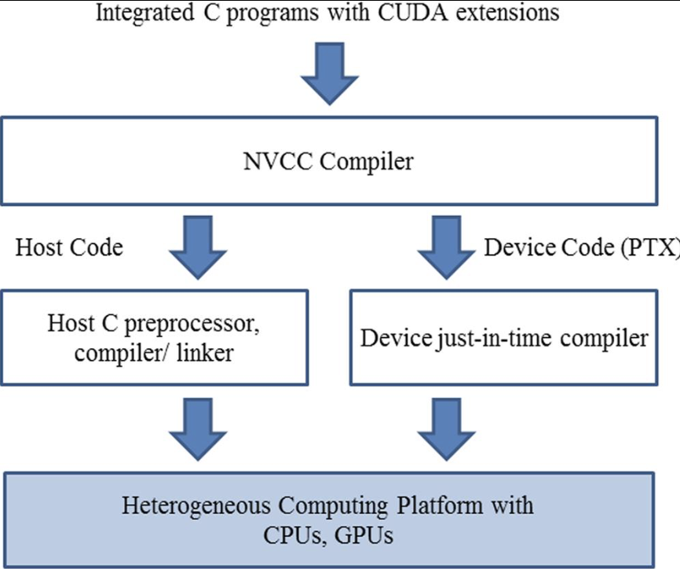
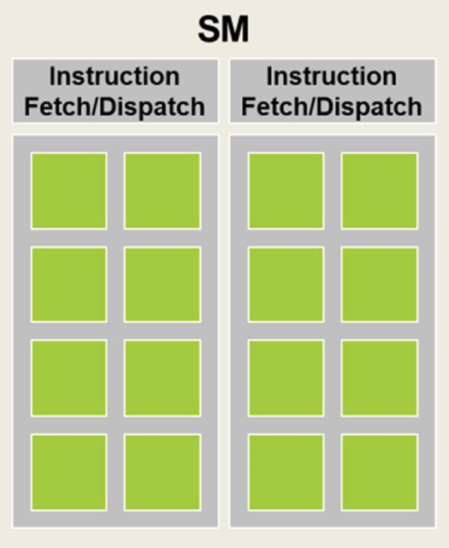
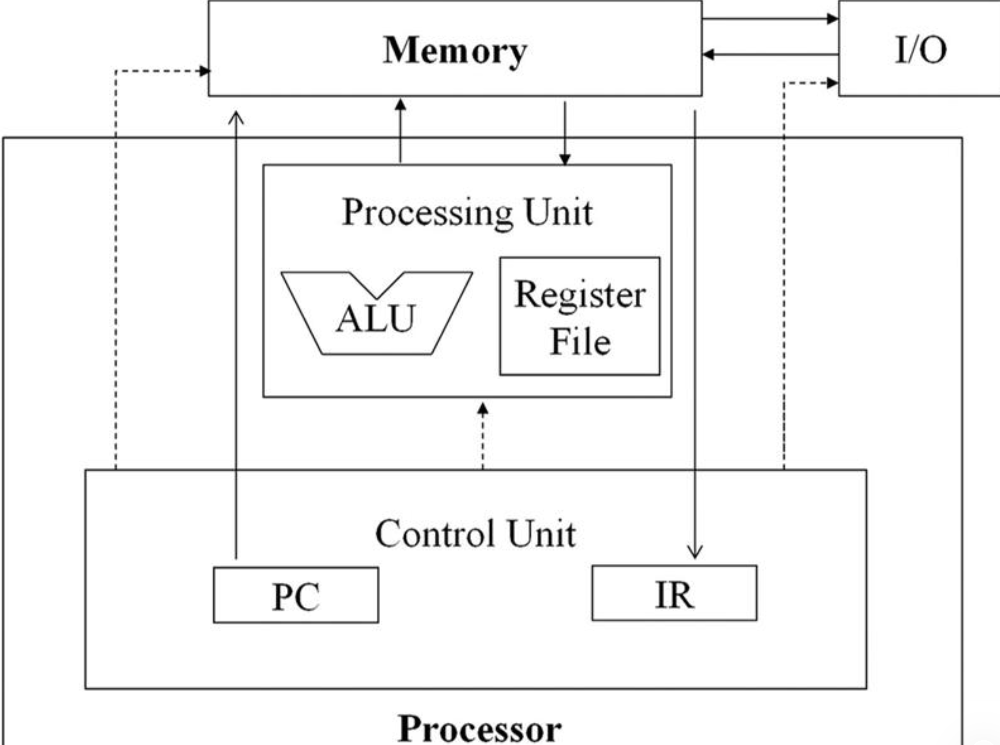
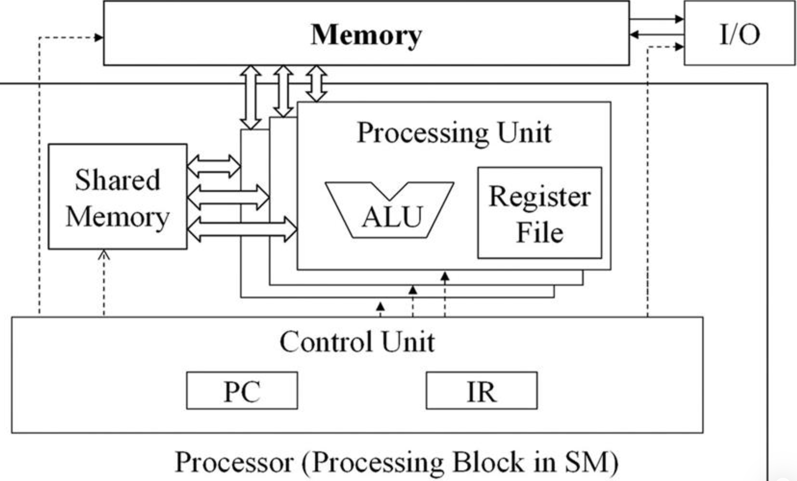
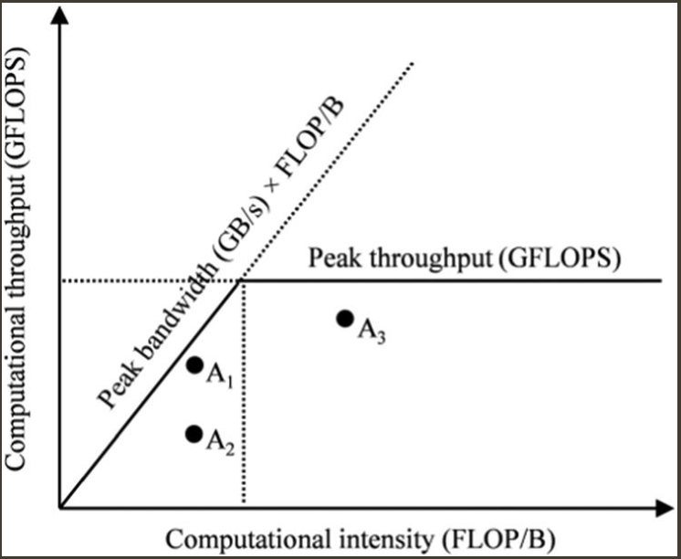
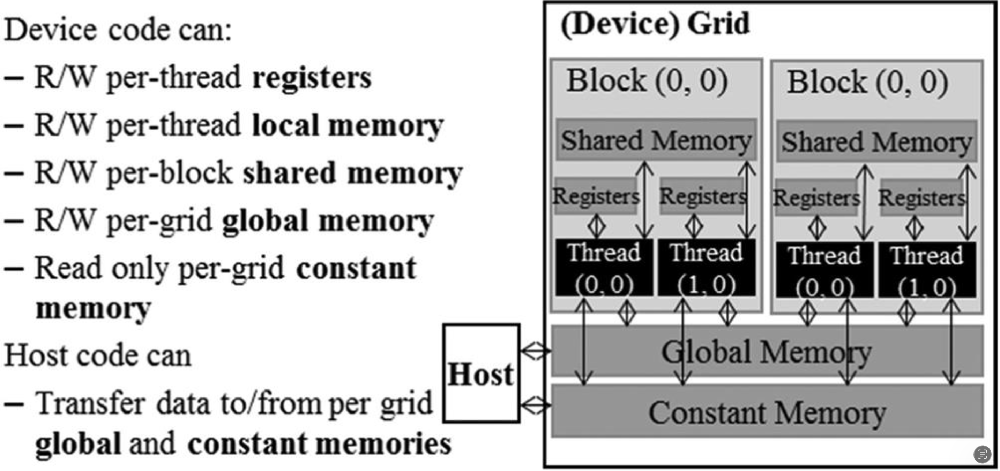

## Ch1
由于硬件支持，cuda threads 的生成和调度开销很小，通常只需几个时钟周期；相比之下，传统的 cpu threads 则需要上千个时钟周期生成和调度

CUDA programmers can assume that these threads take very few clock cycles to generate and schedule, owing to efficient hardware support. This assumption contrasts with traditional CPU threads, which typically take thousands of clock cycles to generate and schedule.

In CUDA, the execution of each thread is sequential as well. A CUDA program initiates parallel execution by calling kernel functions, which causes the underlying runtime mechanisms to launch a grid of threads that process different parts of the data in parallel.

+ `__host__`: callable from host, executed on host

+ `__global__`: callable from host, executed on device

+ `__device__`: callable from device, executed on device


the NVCC compiler processes a CUDA C program, using the CUDA keywords to separate the host code and device code. The host code is straight ANSI C code, which is compiled with the host’s standard C/C++ compilers and is run as a traditional CPU process. The device code, which is marked with CUDA keywords that designate CUDA kernels and their associated helper functions and data structures, is compiled by NVCC into virtual binary files called PTX files. These PTX files are further compiled by a runtime component of NVCC into the real object files and executed on a CUDA-capable GPU device.



## Ch4 Compute architecture and scheduling
GPU 由 SM 构成，SM 中的计算处理单元由 streaming processors，也叫 cuda cores 构成；同一个 SM 内的 cuda cores 共享控制逻辑和内存资源；

A100 的 SM 和 cuda core 规格是：108 SMs with 64 cores each, totaling 6912 cores

调用 kernel CUDA runtime system 会发射一个 grid，threads 会按 block 为单位分配给 SM；因为硬件资源有限，每个 SM 上可同时执行的 block 数也是有限的；runtime system 会维护一个尚未执行的 block 的 list

由于 thread 按 block 为单位分配到 SM 上执行，因此同一个 block 内的 thread 可以进行特有的交互，如 barrier sync、shared memory read/write；

barrier sync 通过 `__syncthreads()` 实现；如果 kernel 中 `__syncthreads` 被包裹在 if-else 语句中，必须保证一个 block 全部走同一个分支，不允许有的执行了 sync 有的没有执行；

即便两个分支都有 `__syncthreads`，block 内 thread 也必须走同一个分支的 `__syncthreads`，否则会来到不同的 barrier，产生 deadlock；

同一个 block 内的 thread 分配到同一个 SM，而且必须同时被分配；因此 runtime system 必须确保有一个 block 所需的硬件资源空闲，block 才能被分配并执行；这保证了 block thread 之间完成时间差不多，不会因为 barrier 而无限等待；

### transparent scalability

> The ability to execute the same application code on different hardware with different amounts of execution resources is referred to as **transparent scalability**, which reduces the burden on application developers and improves the usability of applications.

transparent scalability 指的是同一份 kernel 可以在不同的 cuda 硬件上运行，由于 block 之间没有时序依赖，所以可以以任意顺序发射 block 而不影响最终结果；变化的只是能耗和延迟等因素；

transparent scalability 也导致不同 block 之间的 thread 不能同步

### Warps and SIMD hardware
transparent scalability 保证 block 间无依赖。同样，block 内的 thread 理论上的执行顺序也是任意的，如果一个 thread 的流程有多个 phase，那么就需要多个 barrier sync 来确保 block 内部的同步；

block 内部的同步就涉及 warp，它也是 thread scheduling 的基本单位；一个 block 被分配给 SM 后，内部继续按 threadIdx 分为若干 warp，每个包含连续的 32thread；

根据 block size 和分配到每个 SM 的 block 数，就能算出一个 SM 上有(resident)多少 warp，例如 3 个 256thread block，warp 数就是 3 * 256/32 = 24；

对于单维 block，warp partition 就是根据 threadIdx.x 进行简单的划分；如果 block size 不是 32 的倍数，那么最后一个 warp 会被 pad 成 32 个 thread，有一部分是 inactive thread；对于二/三维 block，warp partition 按 row-major order 划分，按 `[threadIdx.z, threadIdx.y, threadIdx.x]` 的顺序升序排列，yz 相同、x 连续的 thread 连续排列，分配到同一个 warp

SM 执行遵循 SIMD model：

> at any instant in time, one instruction is fetched and executed for all threads in the warp

instruction 的执行以 warp 为单位，这是软件层面；硬件层面，SM 内部的 cuda core 也会按一定数量被划分为多个 processing block；每个 warp 被分配到一个 process group，同一个 warp内的 thread 在同一个 pg 里执行同样的 instruction，但操作的数据对象不同；

换言之，每个 process group 中的若干 cuda core 共享一个 control 单元，负责 instruction fetch/dispatch，供 warp 进行消费：



SIMD 的一个好处是，由于很多 core 对应一个 control unit，所以 control unit 占据的芯片面积就少，更多的面积留给计算单元，从而提高硬件整体吞吐

经典的 von Neumann model 示意图和 GPU version von Neumann model 示意图：





### Control Divergence
在 if-else 分支语句中，如果一个 warp 中部分 thread 走 if，另一部分走 else，那么 warp 会走两个 pass，分别执行这两种 thread 对应的 instruction，pass 会对不属于他的那一部分失效；

在 volta 以前的型号，divergent pass 是串行执行的，从 volta 开始，pass 可以并行执行；

### Warp scheduling and latency tolerance
SM 和 cuda core 的数量有限，而 warp 数量通常比他们都大，这就使得 GPU 可以调度 warp 实现 latency tolerance/hiding，即一部分 warp 进入数据等待状态时，硬件资源可以先执行另一部分 ready 的 warp

### zero-overhead thread scheduling
> The selection of warps that are ready for execution does not introduce any idle or wasted time into the execution timeline, which is referred to as zero-overhead thread scheduling

因为 GPU 的 warp scheduling 和 latency tolerance，导致它不需要有很多的 branch prediction 和 cache 单元来应对耗时的 memory 操作，这样就能腾出空间放更多的 floating-point execution and memory access channel resources（这大概是指用于传输的 DMA 控制器而非 DRAM）

为什么 GPU 能实现 zero-overhead thread scheduling，主要是省去了耗时的 context switch：

> "Traditional CPUs incur such idle cycles because switching the execution from one thread to another requires saving the execution state (such as register contents of the out-going thread) to memory and loading the execution state of the incoming thread from memory. GPU SMs achieves zero-overhead scheduling by holding all the execution states for the assigned warps in the hardware registers so there is no need to save and restore states when switching from one warp to another."

### Resource partitioning and occupancy
Occupancy: the number of warps assigned to an SM / the maximum number it supports

occupancy 越高，通常意味着 kernel 隐藏 latency 的性能越好（可以认为吞吐量越高？）

> 因为 warp size 固定为 32thread，因此 occupancy 也可以用 assigned thread 数量来衡量

occupancy 取决于 SM resource partitioning，包括registers, shared memory, thread block slots, and thread slots 这些硬件资源的划分；

比如，一台 A100 机器可以支持 a maximum of 32 blocks per SM, 64 warps (2048 threads) per SM, and 1024 threads per block；如果一个 grid 的 block size 是 1024，那么一个 SM 最多只能容纳两个 block；

当 block size 较大时（大于 64），thread slot 被填满而不会突破 thread block 数量限制；当 block size 小于 64 时，SM 可容纳的 block 数量只有 32，因此 thread slot 不能被填满；因此，如果要实现 occupancy 最大化，block size 不能小于 64；

同时，如果 block size 不被 2048 整除，比如 768，那么最大 occupancy 是 1536/2048=0.75，因此应该尽量使得 2048 与 block size 的公因数尽可能大（最后半句是我瞎说的）

上述情形并没有考虑其他资源限制，现实情况下有很多 low occupancy 和 register、shared mem 占用相关；考虑一个 register 资源限制相关的情况：A100 每个 SM 有65536 个 register；如果想达成 full occupancy，那么每个 thread 最多只能占用 65536/2048=32 个 register；如果每个 thread 占用 64 个 reg，那么 occupancy 最大只能到 50%；

有的时候，为了提高 occupancy，编译器可能会使用 register spilling 等技巧将一部分 register 放到 memory，但这是以增加 memory 访问时间为代价的，虽然 occupancy 提高，但 grid 总体耗时可能会增长

### performance cliff
考虑一个 kernel，每个 thread 使用 31 个 reg，block size 配置为 512；那么 SM 最多容纳 2048/512=4 个 block，而总 reg 用量为 2048*31=63488 小于 65536 的限制；

现在如果开发者多声明了两个 auto 变量，每个 thread 的 reg 用量变为 33，超过 65536 限制，那么现在最多容纳 block 数就变成了 3；总 thread 数变成 3*512=1536，occupancy 变为 75%，这就是 performance cliff:

> a slight increase in resource usage can result in significant reduction in parallelism and performance achieved

各种动态分配的硬件资源之间的交互很复杂，很难直接推出每个 SM 的 thread 数量或者 occupancy，可以使用下面的 ncu 工具 

https://docs.nvidia.com/nsight-compute/NsightCompute/index.html#occupancy-calculator

### Querying device properties
### cudaGetDeviceCount

现代 PC 系统通常包含 2 个及以上的 GPU 设备，一个用于基础的 GUI 显示，不适用于运行 CUDA 程序；

想要查询 cuda device 数量，可以使用该 API：

```cpp
int devCount;
cudaGetDeviceCount(&devCount);
```

### cudaGetDeviceProperties
想要查询 cuda device 的属性，比如 SM 最大容纳 thread/block 数，reg 数等，可以使用该 API：

```cpp
cudaDeviceProp devProp;
for(unsigned int i = 0; i < devCount; i++) {
    cudaGetDeviceProperties(&devProp, i);
}
```

常见查询属性：

```cpp
devProp.maxThreadsPerBlock;
devProp.multiProcessorCount;
devProp.clockRate;
devProp.maxThreadsDim[0, 1, 2];
devProp.maxGridSize[0, 1, 2];
devProp.regsPerBlock
devProp.warpSize
```
其中 `devProp.regsPerBlock` 并非每个 thread block 的 reg 数，而是每个 SM 的 reg 数；对于大部分 compute capability的设备而言，一个 thread block 能用的最大 reg 数就是 SM 的 reg 数，但有些 cc 情况下不成立

> 改成 `maxRegsPerBlock` 就没有歧义了 hh


## Ch5 Memory architecture and data locality
global memory 是 off-chip DRAM，一次访问通常需要上百个时钟周期，而且带宽有限，因此频繁访问 global memory 会导致性能下降；

对于正常的矩阵乘法运算，常规流程是从 global mem 中取 M 和 N 的各一个元素，相乘然后累加到本地变量 p 中；一乘一加需要访问 2*4byte 数据，因此 arithmetic intensity = 2/8 = 0.25 FLOP/B

### Importance of memory access efficiency
compute to global memory access ratio，也称 arithmetic intensity、computational intensity，定义是 the number of FLOPs performed for each byte access from the global memory within a region of a program

简单理解，即每 byte 数据，进行了多少次浮点数运算；

该 ratio 对于 kernel 整体的性能有重要的提示；以 A100 为例，它的 peak global memory bandwidth 为 1555 GB/s，而它的 peak single-precision operation throughput 为 19500 GFLOPS (giga FLOPs per second) 

那么该 MM kernel 的吞吐受限于内存带宽，为 1555 * 0.25 = 389 GFLOPS，仅达到 peak 性能的 389/19500 = 2%；对于 A100 的 tensor core，其 peak throughput 可达 156,000 GFLOPS，那么该 kernel 性能就只达到 peak 的 0.25%，非常低效

我们把这种执行受限于 memory bandwidth 的操作称为 memory-bound

### The Roofline Model



roofline model 用于评估程序运行性能相比于硬件极限的情况。x 轴表示计算密度，y 轴表示计算吞吐；斜线和水平线代表了硬件的极限性能，斜线的斜率就是内存带宽，水平线的截距即硬件 peak 吞吐

可能存在的点都位于两者下面的区域，表示一个 cuda 程序的性能，xy 坐标分别代表他们的计算密度和吞吐量

有两个推断：

+ 越靠近两条线，表明利用硬件资源越充分，即利用 memory 带宽或计算单元越高效
+ 斜线之下属于 memory bound 区域，受限于内存带宽；水平线之下属于 compute bound 区域，不受限于带宽

两条线的交汇点 x 坐标，以 A100 为例，可以计算得出：19500 GFLOPS / 1555 GB/s = 12.5 FLOP/B；这意味着每个 4byte 的浮点数必须要进行 50 次浮点运算才能打满硬件性能，进入 compute bound 区域

### CUDA Memory Types

下图展示了 CUDA 设备的 memory model：



由图可知，大致有三层 memory，per-thread、per-block、per-grid。这么多的存储层次本质上是为了提高 cuda program 的 arithmetic intensity；

shared memory 和 register 都属于 on-chip memory，在 GPU 芯片上集成，因此访问速度远高于 global memory；这两者之间的区别之一在于访问 shared memory 需要先 load/store 操作；

local memory 实际上的物理位置属于 global  memory，访问延迟相似，但它的 scope 是 per-thread，这块内存用于存放 statically allocated arrays, spilled registers, and other elements of the thread’s call stack.

通过指定 cuda 变量的 memory 类型，我们同时规定了它的 visibility 和 access speed；

| Variable declaration | Memory | Scope | Lifetime |
| :--- | :--- | :--- | :--- |
| Automatic variables other than arrays | Register | Thread | Grid |
| Automatic array variables | Local | Thread | Grid |
| `__device__ __shared__ int SharedVar;` | Shared | Block | Grid |
| `__device__ int GlobalVar;` | Global | Grid | Application |
| `__device__ __constant__ int ConstVar;` | Constant | Grid | Application |

对于 lifetime 为 grid 的变量，应该在 kernel 函数体内声明，它们会在 kernel grid 执行完毕后被丢弃；对于 lifetime 为整个 application 的变量，应该在 host 端（kernel 之外）声明，保证能被所有 kernel thread 访问到；

对于 automatic scalar/array，kernel 函数体生命的变量会为每一个 thread 分配这样一个变量，在 reg 或 local mem 中；

对于 `__shared__` 变量，会对每个 block 分配这样一块共享内存；

对于 `__constant__` 变量，会在 CUDA constant memory 中分配一份内存供所有 grid 访问；kernel code 无法改变 constant memory 值；当前 constant mem 最大限制为 65536 bytes；可以通过 cache 来更快的访问 constant memory；

### Tiling for reduced memory traffic
tile 的核心思路是通过将数据和计算 tile 化，线程按 tile 来将划分数据和划分计算步骤，保证 tile 对应的计算在本次 tile load 中全部完成，后续再也不需要重新从 global mem 中 load 这一块数据；

也可以说，tile 对单个 thread 进行了划分，使得一个 thread 的计算分为不同阶段，每个阶段和其他 thread 共同处理一个 tile；不同的阶段处理不同的 tile

因此，数据在这种情况下的复用次数即为 tile 的维度

